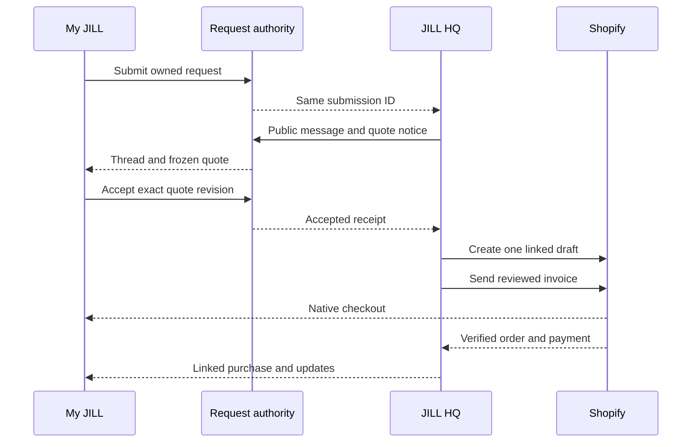

# JILL HQ ↔ My JILL customer handoff — WORK decision

Updated 2026-10-18. Scope: the existing WORK Shopify app, My JILL full-page extension, HQ merchant app, WORK custom-request gateway/Google QA and WORK D1. Physical machine inventory, production capacity, LIVE and KEEP are outside this release. This document refines `JILL_ORDER_DESK_MASTER_BLUEPRINT.md` and `WORK_HQ_ORDER_WORKSPACE_ROADMAP.md`; it does not activate a Shopify scope, customer write, invoice, deployment or email.

## Decision: one request, two authorized views, one Shopify purchase

My JILL gets an **Inbox** inside the existing Custom Orders screen: an index of the customer's own requests, each opening a conversation and quote panel for that `submission_id`. HQ gets the merchant view of the **same request thread** in its existing request workspace. Do not install a second customer-account page, create a general chat database, or put customer conversations in a Shopify order note. Shopify's native Orders page remains the purchase/fulfillment view; My JILL gives the request context and a verified link to that native order.

The diagram shows the intended lifecycle, **not** a claim that quote publishing, replies, approval or Shopify draft creation is deployed. A customer accepting a quote authorizes the commercial handoff; a Shopify **Draft Order** is created first. A regular Shopify Order exists only after Shopify checkout or an explicitly authorized completion. Customer acceptance alone is never marked Paid.

## Screens and actions

| Surface | Customer or merchant sees | Writes and permission |
| --- | --- | --- |
| My JILL / Custom Orders | Own requests sorted by last public activity; request number, status, last message, quote action, linked native order/checkout action when verified | Shopify customer session and owner ledger select the list; no typed customer/email filter. |
| My JILL / request thread | Public status milestones and messages in chronological order, authored as `JILL` or `You`; approved artwork references only after private-media release | Reply text and Accept / Request changes / Decline for the displayed current quote, each with a fresh session, expected revision and one operation ID. No staff notes. |
| HQ / request workspace | Original request, verified owner, customer conversation, internal notes, quote revisions, Shopify link and delivery state | Shopify online staff + D1 grant. Existing message/status command remains the merchant writer; quote publish and invoice send require Owner or specifically granted staff plus Shopify permission. |
| Shopify native customer account | Invoiced draft/checkout and later order history, payment and fulfillment | Shopify owns invoice, checkout, charges, tax, order and fulfillment. My JILL shows a link and a read-only verified projection, not another payment form. |

The initial Inbox is an **index of per-request threads**, not a second inbox authority. Display the latest source revision and a refresh action. Defer unread badges until a separate, durable per-customer read cursor is defined; do not call a locally cached timestamp an authoritative unread count. Keep bounded pages and source-unavailable states; the current customer reader caps lists at 20 requests and timelines at 100 events, and the Google merchant feed has its own 50-request/500-event bounds. Pagination and retention must be designed before conversations exceed those limits.

## One data contract across the two apps

| Object | Owner / durable key | Rule |
| --- | --- | --- |
| Request | Google QA Submissions + CustomOrderOwners; `(shop, submission_id)` | Immutable original intake. Verified Shopify Customer GID owns a signed-in request. A contact email can differ from the signed-in email and does not change ownership. |
| Conversation and production history | Append-only Google QA CustomOrderEvents; event ID, source revision, actor class and public body | Extend the existing event kind to distinguish public merchant message, authenticated customer reply, public status and quote notice. Keep internal notes private. HQ and My JILL consume different whitelisted projections of this one history. |
| Quote draft | Existing WORK D1 `jill_work_quote_drafts` and operation table | Current schema stores only a mutable private `draft`. Add separate immutable published revisions and acceptance receipts when implemented; never mutate a published version in place. |
| Quote acceptance | WORK D1 `(shop, submission_id, published_quote_revision, quote_hash, customer_gid, operation_id)` | Customer approval is an auditable agreement to exact displayed terms, not an email click or a payment. One accepted revision at a time; duplicate command returns its original result. Never store customer JWT or raw payment data. |
| Shopify handoff | A unique WORK D1 request-commerce link to Shopify DraftOrder GID and later Order GID | Shopify resources carry the exact submission ID and quote revision in reviewed metafields/attributes; read back each resource. No email/name matching or second editable payment state. |
| Email | Separate notification/outbox receipt and Shopify invoice record | My JILL is the conversation source. Optional email says an update awaits sign-in, without private content or a direct accept token. Shopify's invoice email is sent by `draftOrderInvoiceSend`; an email reply is not silently imported into the request thread. |

Customer reply path: the existing My JILL customer reader obtains a fresh Shopify session token; a bounded POST endpoint verifies it, derives the Customer GID, checks `CustomOrderOwners` for the chosen `submission_id`, rate-limits, validates body and expected revision, and signs an internal command into the **same Google event writer**. The browser never receives the HMAC key or chooses an owner GID. The current Google `kind=message` command is merchant-only, so it cannot be reused as a customer authorization path without this new verification and event contract. A duplicate/uncertain result is read back by operation ID, not resubmitted blindly. Customer B, guests without a verified claim, and staff lacking an HQ grant see no other customer's thread.

Guest requests continue to work as requests. A guest gets a safe reference and contact follow-up; they cannot Accept in My JILL until a separately verified account claim binds the exact request to their Shopify Customer GID. Typing the original email, receiving an invoice, or paying does not grant access to someone else's history. The verified claim flow can be delivered after the signed-in path, but the UI must explain this limitation.

## Quote to Shopify state contract

| State | Trigger and durable proof | Customer presentation / next action |
| --- | --- | --- |
| `request_received` / `in_discussion` | Canonical intake and public events | Thread open; quote absent; customer may reply. |
| `quote_prepared` | Private D1 Save/Reload, source revision and quote hash | HQ only. Nothing price-authoritative or payable in My JILL. |
| `quote_published` | Authorized staff freezes version, items, variant IDs, quantities, personalization summary, fulfillment, verified address, Shopify-calculated tax/shipping/discount/total, currency, expiry and hash; append public notice | My JILL shows exact terms and Accept / Request changes / Decline. Any change produces a new version and invalidates old acceptance. A requested date is not a confirmed delivery promise. |
| `acceptance_recorded` | Fresh customer JWT, exact owner, unexpired quote, hash/version and expected source revision, atomic D1 operation receipt | Show “Approval received; preparing checkout.” If event projection or downstream Shopify is unavailable, show pending verification, never a made-up order or Paid badge. |
| `draft_linked` | Previously authorized exact merchant intent, unique D1 command/link, `draftOrderCreate` response and read-back of the same customer, lines, totals and submission ID | HQ sees the actual Shopify draft. If totals/customer/address differ, hold and require a new quote approval. No silent mutation. |
| `invoice_sent` | Owner or authorized Administrator confirms recipient, amounts and draft; Shopify `draftOrderInvoiceSend` succeeds and is read back | Verified owner may see Shopify checkout action; Shopify may also list the invoiced draft in native Orders. Do not send two separate “pay now” emails. |
| `shopify_order_verified` | Shopify's draft→Order relationship and fresh order/payment read, with matching customer and link metadata | My JILL shows the linked native order and real payment/fulfillment observations; HQ shows the same Shopify order. The JILL request thread remains for production updates. |

Use Shopify `draftOrderCalculate` for the pre-publish price/tax/shipping preview; it calculates without creating a draft and requires `write_draft_orders`. `draftOrderCreate` creates the draft from the frozen accepted terms and requires draft-order management permission; `draftOrderInvoiceSend` sends Shopify's actual checkout invoice. The WORK app's last known installed scope list did not include `read_draft_orders` or `write_draft_orders`; inspect the **current** version and grants before configuring either. Published approval must be rechecked against Shopify-calculated totals and actual DraftOrder read-back, since store rules, destination or availability can change between approval and creation.

Rewards is part of that exact quote. Follow `JILL_REWARDS_WORK_FLEX_REDEMPTION.md` for the selected universal 1 point = $1 policy with $10 eligible subtotal per $1 reward, in 0.1-point steps: My JILL requests one exact amount through the canonical Rewards owner; HQ includes that customer-targeted code in Shopify's draft calculation before quote publication and verifies the calculated discount. Freeze the reward code/value with the quote version, then attach the same code to the draft created after acceptance and read back its totals. A changed or expired reward requires a new calculation and customer acceptance. Do not deduct points again in HQ or add a second manual draft discount. The new policy is a WORK target and the current fixed Rewards v13 terms continue until a separately proved release.

For the initial WORK release, **customer acceptance queues one draft creation; HQ reviews and explicitly sends the invoice**. At quote publication, authorized staff approves the precise future draft intent and scopes; the background worker checks that authorization and current revocation before acting. This gives a smooth customer approval without granting a customer an Admin API write. If Shopify creation times out or returns an unclear result, stop in `needs_reconciliation`, search/read the recorded link and tagged/metafielded draft, and require operator review before a retry. A customer never triggers a second `draftOrderCreate` by clicking Accept again. Later automatic invoice sending is a separate policy and QA decision.

The cross-system acceptance is a recoverable sequence: commit the D1 acceptance and outbox intent atomically first; append a public accepted event through the canonical Google writer with the same operation ID; only after that event is confirmed may the preauthorized Shopify draft command run. If Google is unavailable, My JILL shows the durable receipt as **processing**, HQ sees a reconciliation task, and no draft is created yet. If Shopify is unavailable, the accepted event remains true while checkout stays unavailable. A worker crash resumes from the stored operation ID and read-back, with no second accepted quote or blind Shopify create.

No automatic `draftOrderComplete` upon approval. Shopify checkout creates the paid order in the normal flow; manual completion, deposit and partial payment are separate reviewed operations. When Shopify reports an order, re-read DraftOrder.order and the Order; do not assume draft metafields transferred. Link the Order with a verified reference and keep Shopify's native customer order history. A customer-ID mismatch quarantines the commerce link and hides invoice/order data in My JILL until resolved.

Use a short explicit quote expiry and reconcile aged unpaid drafts. Shopify may purge an inactive draft after a year; an unavailable old draft is an exception for HQ review, never a reason to silently recreate an invoice or mark the request paid.

## Delivery plan and one integrated test

1. Pin the active WORK app, extension UIDs, HQ/gateway Worker versions, current scopes and two existing request receipts. Resolve the gateway's changed-deployment hold and classify the 409 without another customer submission.
2. In source, add a versioned public event projection and signed customer reply command through the existing owner-verified reader/Google writer. Test Owner → My JILL message, customer reply → HQ, stale revision, duplicate, wrong customer/shop, guest, rate limits, timeout and overflow. Release with customer write disabled until authenticated WORK proof.
3. Add immutable published quote revision, exact Shopify calculation snapshot and D1 acceptance/operation receipts. Prove preview → freeze → read → Accept/Decline/Request changes → new revision using one synthetic WORK customer. Keep existing draft Save/Reload as the editor, not the agreement record.
4. Review/re-authorize WORK `read_draft_orders`/`write_draft_orders` and staff permissions in a staged app version while preserving the three My JILL extension UIDs, proxy, URLs and existing scopes. Then test one synthetic accepted quote → exactly one draft and read-back. No invoice email during this test.
5. Test explicit HQ invoice send to the designated WORK test customer, Shopify checkout, DraftOrder.order→Order linkage, paid/pending/refunded observations and native Orders visibility. Verify My JILL's thread and commerce link with customer A and denial for B. Record rollback versions and reconcile missing/duplicate webhooks against fresh Shopify reads.

No real customer message, approval, Shopify draft/invoice/order write, D1 migration, app version release, paid service or LIVE/KEEP operation is part of this source decision. The test must use a disposable WORK fixture, and each externally visible step has a separate reviewed release diff.

## Shopify platform references (2026-07 Admin API)

- https://shopify.dev/docs/api/admin-graphql/2026-07/mutations/draftOrderCalculate
- https://shopify.dev/docs/api/admin-graphql/2026-07/mutations/draftOrderCreate
- https://shopify.dev/docs/api/admin-graphql/2026-07/mutations/draftOrderInvoiceSend
- https://shopify.dev/docs/api/admin-graphql/2026-07/objects/DraftOrder
- https://shopify.dev/changelog/posts/draft-orders-automatically-purged-after-1-year-of-inactivity
- https://shopify.dev/docs/apps/build/customer-accounts
- https://shopify.dev/docs/apps/build/customer-accounts/capabilities
