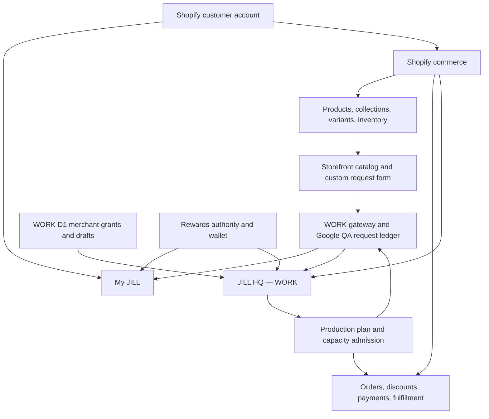

# JILL HQ — WORK system map and connection contract

Updated 2026-10-18. Scope: `jill/rewards-work`, `jill-work.myshopify.com`, the isolated WORK app and QA services. This is the current integration map and the acceptance contract for the remaining HQ work. The detailed domain contracts remain in `DOMAIN_OWNERSHIP.md`, `JILL_ORDER_DESK_MASTER_BLUEPRINT.md`, `CUSTOMER_ACCOUNT_HYBRID.md`, `JILL_HQ_WORK_SCOPE.md` and the WORK release records. Earlier dated status paragraphs in those documents are historical, not a current deployment inventory. LIVE and the Git KEEP branch are outside this map.

## One business graph

Every arrow is an independently authorized contract, not a shared customer database. In particular, HQ is a merchant application; My JILL is a customer account extension. Their identities and permissions are different. The production plan and capacity admission arrows are **planned**, not active.

## Authorities, joins and present proof

| Domain / HQ surface | Canonical source and stable join | WORK evidence as of this map | Next certified connection |
| --- | --- | --- | --- |
| Merchant identity, staff and access | Shopify online staff ID and scope intersected with one D1 grant for the exact WORK shop | Embedded WORK HQ, OAuth and Owner commissioning have been reported working; commissioning switch is OFF. Prior WORK evidence identified active app version `jill-hq-work-7`. Inbox/detail Owner gate exists in source. | Recheck active app version, online effective scopes, revocation and role denial on the deployed version before widening any view. |
| Customer identity and profile | Shopify Customer GID from verified customer-account context; Shopify owns email, addresses and order history | My JILL and customer-owned request were shown together in WORK. The editable request email is contact information only. | Owner-scoped Admin customer query with field minimization and pagination; customer account continues to see only its own data. Never join by typed email. |
| Products and variants | Shopify Product/Variant GIDs, Shopify status, price and stock; `custom.jill_product_capabilities` plus `merchant/jill-catalog-capabilities.mjs` define configured behavior | Theme catalog, collection discovery, product options and custom request composition exist in source. No authenticated current WORK Admin catalog inventory was obtained for this map. | Add WORK app `read_products` only after app-version/scope review and reauthorization; build an Owner-scoped read projection that links to Shopify Admin rather than copying catalog truth into D1. |
| Collections | Shopify Collection GIDs, membership, publication and order | Storefront collection and Catalog Hub source exists; HQ has no certified collection route. | Read Shopify collection edges alongside products, classify unpublished/missing-capability items, retain Shopify as editor. Do not infer capability from collection names. |
| Inventory and locations | Shopify InventoryItem/InventoryLevel and Location GIDs, with inventory availability read from Shopify | No HQ stock feed or measured stock audit in this map. | Separately review `read_inventory`/location permissions and add a bounded, fresh read projection. Stock does not represent made-to-order labor capacity. |
| Custom request and production events | Immutable `submission_id` (`jill:UUID`), Google QA Submissions, CustomOrderOwners and append-only CustomOrderEvents | WORK inbox, exact detail and status command paths have prior Owner evidence. Request `#6AB4D8B8` was visible in HQ and My JILL. The later gateway 409 and deployed-version proof remain unresolved; do not resubmit or infer success. | Resolve the 409 category and compare exact gateway/Google receipt on an isolated fixture, then certify one event reflected in both HQ and the owning My JILL account. |
| Quote proposal | `(shop, submission_id, source revision, quote revision)` in WORK D1 | Two empty quote tables were migrated in WORK; Save/Reload is source gated and locally tested. Prior v35 0% attempts and runbooks are historical, not proof of active quote traffic. | Check current HQ Worker version/flag and authentic Owner Save → leave → Reload on a synthetic request, with stale-revision rejection. |
| Draft order, invoice and paid order | Shopify DraftOrder/Order GIDs linked to the immutable submission ID in one audited registry; Shopify owns calculated totals, payment and fulfillment | Blueprint only. Existing WORK app scopes do not establish `read_draft_orders`/`write_draft_orders`. | Review scopes, staff permission, idempotent link/reconciliation and recipient confirmation before any creation or invoice delivery. Never set paid in HQ. |
| Rewards, coupons and customer wallet | Existing Rewards v13 ledger and Shopify discount/customer metafields; Shopify checkout applies discounts | WORK My JILL Rewards/Offers paths and existing backend have separate QA history; HQ has no merchant-wide Rewards dashboard. | Read-only aggregated Rewards observation from canonical backend after access/privacy review; preserve its reconciliation and redemption authority. |
| Customer messages and email | Public request event in the canonical CustomOrderEvents ledger; separately audited email delivery result | Messaging concept and commands have source history. A working WORK email provider and real delivery proof are not established here. | Consent/template/delivery and owner-account visibility tests; no automatic email implied by status or a contact field. |
| Private artwork | Owner-bound metadata and authenticated short-lived retrieval, with object bytes in approved private storage | Extensive source/local tests and a proposed registry exist; remote private-media activation is not established. | Storage/privacy/cost review, isolated synthetic media, then permission and expiry QA; never expose object URLs to another customer. |
| Production resources and commitments | A future dated reservation ledger linked to submission/order IDs; Shopify inventory remains material/stock authority | No verified machine inventory, throughput, reservation ledger or production admission is deployed. | Measure the inputs below, then implement atomic reserve/release with staff audit before promising a production slot. |
| Analytics and source health | Bounded projections over the above owners, with timestamps, errors and reconciliation IDs | HQ sections currently describe planned modules; no certified all-business overview counter exists. | Show only source-qualified counters and stale/unavailable states; do not treat an upstream error as zero. |

**Freshness rule:** source code, local workerd tests, a Cloudflare version allocation, an anonymous health response and a signed-in business operation are separate proof levels. The current gateway allocation reported by the Owner is `9322193f-5e87-4479-88c9-39229dddb5f2` at 100% and `408bdf7c-eb20-4b6e-97dd-3d3b293c6120` at 0% on `jill-work-custom-orders-qa`. The version-tail script held because its expected deployment changed. This says nothing about the separate HQ canary's active version or its quote flag. No customer submission or remote write follows from this receipt.

## Data collection contract

Capture only data needed for a stated business operation. Each record needs an owner, purpose, access rule, retention/deletion rule and provenance. Do not centralize raw customer records merely to make HQ look complete.

| Entry point | Collect | Binding and access | Avoid / unresolved |
| --- | --- | --- | --- |
| Native account and checkout | Shopify's profile, address, order and payment data | Shopify identity and native permission model | Copying passwords, payment details or an all-customer export to D1. |
| Product purchase | Variant ID, quantity and validated capability payload / line item properties | Shopify cart and order line; only required customization | Duplicated collection-based option logic or prices calculated in theme/HQ. |
| Custom Order form | Items/quantities, requested date and fulfillment, contact preference, bounded notes and consent, stable submission ID | Gateway's validated receipt; signed-in Shopify Customer GID from verified context; guest claim remains separate | Treating contact email as account proof; unlimited raw payload; claiming price or date confirmation upon request. |
| My JILL | Authenticated self reads, explicit Rewards redemption, separately consented preferences | Customer GID; backend ownership checks on each request | Another general customer database; reminders or marketing inferred from order data. |
| HQ | Minimum Owner/role-scoped projection, audit of commands, source freshness | Shopify online staff ID + D1 grant + exact shop; per-record checks | Browser-provided role; unrestricted staff/customer lookup; private media in logs. |
| Production | Resource class, job time, availability, backlog, material need, actual completion | Submission/order reference and audited reservation; aggregate timing without customer PII | Promising a date from Shopify stock alone or counting an unaccepted request as paid work. |

For all new projections: bounded pagination, explicit `asOf`/source revision, field whitelist, no-store for private responses, role/owner checks before upstream calls, and a visible unavailable state. For writes: stable operation ID, expected revision, one canonical owner, retry reconciliation, append-only audit and a safe rollback/release path. A webhook is a signal to reconcile against Shopify, not financial truth by itself.

## Physical production: inventory and machine decision

The last specific equipment report recovered from the Owner (May 2026) is a **pink HTVRONT Auto Heat Press** used for shirts, totes and transfers. The Owner described sublimation for 11 oz mugs; a separate mug press or suitable convection oven was identified as needed for that process. This does **not** prove which mug equipment is currently owned. JILL is primarily a party store, with apparel an add-on; number-shaped and round personalized piñatas need their own hand-assembly routing. DTF, vinyl and sublimation are catalog methods, not evidence of owned machines. The repo has no current equipment register, purchase record, measured run times, weekly demand or maker-hour schedule. Machine purchase count is therefore **undetermined**, not zero.

One private Owner-maintained capacity inventory should contain:

| Field | Meaning / example of evidence |
| --- | --- |
| Resource ID, class, count, status | Actual distinct heat press, mug press/oven, printer, cutter, assembly bench, finishing/packing station; owned/borrowed/planned/retired; no assumed model. |
| Job family and routing | SKU/capability → ordered steps (design, print, cut, press, hand assembly, dry/cure, quality check, pack); compatible machine classes. |
| Setup and cycle minutes, batch size, yield | Timed normal runs, rejects/rework and warm-up; separate operator-attended from machine-occupied time. |
| Available hours and reliability | Weekly working hours, number of trained people, breaks, maintenance/downtime; do not count unattended machine time as extra labor. |
| Material and space constraints | Stock/replenishment lead time, safe storage, work surface, power/ventilation where relevant. |
| Demand and backlog | Accepted paid units by job family and promised week, open quotes separately, seasonal/rush scenario, actual completions. |
| Cost and acquisition evidence | Purchase/consumables/maintenance, vendor lead time and budget; review only once a bottleneck is measured. |

For each future week, calculate required minutes by resource and person:

`required resource minutes = Σ accepted units × (setup minutes / batch size + cycle minutes / yield)`

`usable resource minutes = owned machine count × scheduled minutes × observed uptime`

`usable labor minutes = trained person hours × 60 − committed non-production minutes`

Account for material arrival, predecessor steps, drying, QA, packing and current reservations. Utilization is `required / usable`; the bottleneck is the largest overload across resource, labor and material/date constraints. Compute a proposed extra machine count **only** when a machine class is the measured bottleneck, workers/materials/space can feed it, and demand persists beyond the purchase lead time: `max(0, ceil(required machine minutes / usable minutes per machine) − owned compatible count)`. When labor or material is the bottleneck, another machine's estimated useful count is zero for that scenario. Use peak-week and ordinary-week views; never derive demand from site visits or one million hypothetical customers. Until the inputs exist, HQ must show `capacity unmeasured`, not a delivery promise or purchase suggestion.

Before an automated promise, the Owner defines slot units and cutoff/calendar. An atomic ledger must reserve only after a verified commitment policy (quote acceptance/payment as applicable), guard duplicate retries, release on cancellation/refund according to an audited rule, and reconcile with Shopify and the request event stream. Ordinary ready-to-ship inventory stays on Shopify's native path.

## Connected release sequence, with one end-to-end fixture

This is a dependency graph for a **single integrated business flow**, not independent feature launches. Keep one synthetic WORK customer, one product/variant, one collection, one submission ID, one Owner and one test staff identity. Record the exact app/Worker/Google versions and expected scopes for each run.

1. **Baseline and identities:** read current WORK Shopify app version/scopes and HQ/gateway allocations; verify My JILL UID, app proxy, OAuth Owner grant and non-Owner denial. Pin the current known-good rollback. Resolve the gateway tail script's changed-deployment hold from fresh metadata without retrying an order.
2. **Catalog and accounts:** audit actual WORK products/collections/variants/capability metafields; certify customer self read and Owner-scoped customer projection, using Shopify IDs. Review `read_products`, `read_inventory` and draft scopes before altering the WORK app version. A scope release includes all three customer-account extensions and proxy configuration.
3. **Request and communication:** one synthetic customer selects a catalog variant, submits once, receives a verified receipt, sees the same request in My JILL and HQ, and sees one Owner event reflected in both. Classify any 409 by the upstream operation before deciding whether it is a duplicate, ownership conflict or other error. Do not replay uncertain writes.
4. **Quote and commerce:** certify D1 Save/Reload and stale revision in the authenticated WORK HQ Worker; then a separately scoped Shopify draft link, invoice, payment observation and fulfillment reconciliation against the *same* submission ID. Only Shopify marks financial state. Customer-facing email and My JILL message are separate audited outputs.
5. **Physical capacity:** measure actual routing, machines, staff hours and backlog; show a read-only weekly capacity projection first. Add atomic reservation and customer date promises only after this projection matches real work and cancellation/rework behavior.
6. **Overview and scale:** build HQ counters from the already certified domain projections with source freshness and bounded reads. Test role denial, wrong customer/shop, duplicate requests, stale reads, upstream outage and rollback for the whole fixture. Then consider a broader WORK audience, private media or any paid capacity with separate review.

No deployment, D1 migration, external write, store release, paid plan, new customer email or equipment purchase is authorized by this map. The current task can advance source design and local validation. The runtime gates remain tied to observed WORK credentials and a reviewable release diff.
