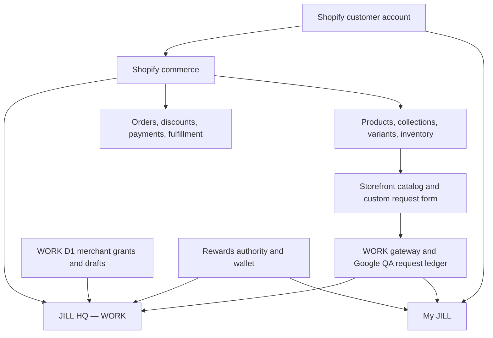

# JILL HQ — WORK system map and connection contract

## Visual-only steering — shared compact HQ theme prepared

The Owner requested a wider, more compact, consistent design across all HQ
tabs. `JILL_HQ_VISUAL_SYSTEM.md` defines the shared theme/template and the NEW
one-use WORK visual release. Six actual route components passed 24 local
Chromium/Polaris viewport cases with synthetic data, no horizontal overflow
and 44px phone controls. The AST/file guard proves handlers, hooks, behavior
attributes, controls and customer/policy copy unchanged. No visual deployment
has been performed yet; Owner Cloudflare credentials remain necessary.
Current operational baseline/receipts below are retained, all spent receipts
remain spent. Existing quote/conversation/media/commerce/Rewards activation
and acceptance gates are unchanged. Full WORK NOT PASSED; LIVE separate.

## Superseding successful WORK HQ activation — 2026-10-19 14:08 UTC

Owner runner `5bacc072da880df28b27a21ec5074cb1885a9a35` completed the exact
reviewed activation. Deployment `d5d1f522-fcc0-4fbb-9052-dc9d951e6029` serves
`e866e2f2-0746-44d0-8caa-b37a1c9bcf45` at 100%, retaining existing quote
canary `dbc6341f-de7f-41de-8e97-6bf971201eeb` at 0%. Unpinned health returned
HTTP 200, healthy D1 and that exact candidate runtime UUID. Catalog is ON;
ordinary quote drafts and conversation are OFF. Existing bindings were
preserved. No re-upload, secret, schema/data or billing change occurred.

Upload and activation receipts are SPENT. Do not repeat either command or
reset receipts. The successful read-only inspection before activation proved
all five metadata reads and the unchanged original allocation, with no
activation/restore receipt present. The earlier Cloudflare read failure was
not reproduced; its underlying cause remains unknown. Structured receipt:
`evidence/work-hq-connected-activation-2026-10-19.json`.

**This supersedes the earlier pending/not-activated status below.** Actual
online Owner scope intersections and catalog UI/source read-back are still
OPEN. Next use the authenticated existing WORK app: Owner access diagnostics,
then catalog products/collections/inventory/locations. Expected runtime UUID
is `e866e2f2-0746-44d0-8caa-b37a1c9bcf45`. Preserve screenshot/resource proof;
never infer stock/capacity from the 60 untracked variants. No further release
or generic app-dev command is needed for this UI check.

Quote canary Save → leave → Reload, original uncertain intake reconciliation,
Google/conversation A/B activation, exact commerce, canonical Rewards, staff
revocation, guest/media and authenticated performance remain OPEN. Full WORK
operational acceptance: NOT PASSED. Customer-facing LIVE: separate review.

## Exact inactive HQ candidate receipt — 2026-10-19

Owner runner `69b709d9c2c6d0a4c075bef073381ec698b39373` uploaded and
independently inspected candidate `e866e2f2-0746-44d0-8caa-b37a1c9bcf45`.
Package SHA-256: `02aae15f15057c74286dac63400e3883189a3d7f5701ea25f35f99a77655a035`.
Existing bindings/runtime were preserved; catalog ON, quote drafts and
conversation OFF. Original HQ deployment `d10596df-fb98-4e6d-8b3d-a3bd0e4deaf0`
remains old version 100% / existing quote canary 0%. No deployment, secret,
data/schema or billing change occurred. Upload receipt is SPENT; never stage
again. Structured evidence: `evidence/work-hq-connected-read-inactive-2026-10-19.json`.
All three triggered CI runs for that source succeeded; this is not operational
acceptance. The prior candidate-not-uploaded paragraphs are historical.

Exact WORK activation and read-only recovery are prepared in
`WORK_HQ_CONNECTED_READ_RELEASE_2026-10-19.md`. Activation still requires the
Owner's existing Cloudflare credentials. Authenticated catalog/staff proof,
quote Save/leave/Reload, conversation A/B, commerce, Rewards, guest/media and
performance acceptance remain OPEN. Full WORK NOT PASSED; LIVE separate.

## 2026-10-19: scope consent complete, HQ catalog candidate prepared

Owner inventory at 13:36 UTC confirms the existing HQ 100/0 allocation and
quote flag on the 0% version only. The Shopify scope release and independent
granted-scope read are complete; online staff evidence remains open.
`WORK_HQ_CONNECTED_READ_RELEASE_2026-10-19.md` defines the NEW inactive HQ
catalog/access upload and its immutable one-use receipt. No provider upload,
HQ traffic change, conversation/media activation or operational acceptance
is claimed. Preserve the existing quote canary and all spent receipts.

## Current continuation — authenticated reads and independent source

See `WORK_OPERATIONAL_HANDOFF_2026-10-19.md` for the exact completed source,
read-back evidence, missing failed-operation correlation and Owner credential/
consent gates. Fresh authenticated Google QA reads verify existing rows,
received events and immutable owner hashes; they do not yet identify the
original uncertain operation. Current Shopify grants still have the five
reviewed gaps. Catalog collections/inventory/locations now have bounded
Owner/scope-gated source and UI; not activated in HQ. Agreement recovery now
survives expiry without repeating a create. Full WORK acceptance remains open.

## Superseding Owner receipt — 2026-10-19

The Owner completed the corrected diagnostic from runner `432f2bc4923bc6f794c2a8b65351574d60a76ecc`.
Source package SHA-256: `eb8561c1f1b5a4e229db7800cc75e67aed1619e7aac15ac7bb044dea62604de3`.
Gateway deployment `4fad4b6f-3596-4797-83a3-05edb7f89097` retains ordinary candidate
`9322193f-5e87-4479-88c9-39229dddb5f2` at 100% and corrected diagnostic
`b6237ad9-3343-4c8b-8b65-7a0194ddc50e` at 0%. The signed response identified
that exact corrected version and verified the Google signature. No customer
order was created or Shopify submission tested; ordinary traffic, old receipts
and secrets were unchanged. Owner-to-edge interval: −458..+687 ms, RTT 146 ms.
The isolated Google QA audit/key preflight passed; the numeric revision was
not in the final receipt and remains to be retrieved read-only when needed.

**The diagnostic failure is closed. The original uncertain intake / earlier
409 remains unreconciled. Full WORK acceptance remains NOT PASSED.** This is
Owner-supplied runtime evidence, not a new signed probe by this executor.
Structured receipt: `docs/evidence/work-gateway-zero-byte-owner-success-2026-10-19.json`.

**All old and new upload/deployment receipts are spent. Never rerun
`work:gateway:empty-post:release-once`, reset receipts or replay historical
upload/recovery/deployment commands.** Only `work:gateway:empty-post:inspect`
may be used for necessary read-only deployment read-back; it sends no signed
POST. Do not restart secret-mismatch diagnosis or rotate keys.

## Fresh execution addendum — 2026-10-19 UTC

The authoritative continuation is
[`WORK_CONNECTED_ACCEPTANCE_2026-10-19.md`](WORK_CONNECTED_ACCEPTANCE_2026-10-19.md).
Fresh WORK Shopify reads verified the existing custom app and its 11 installed
scopes, USD Basic App Development, 15 products/60 variants, seven collections,
two active locations, 15 valid capability profiles and one canonical QA wallet
snapshot. Product/inventory/location and draft-order scopes are absent; all
variants have inventory tracking off. Connector read authority is not the
custom app's online staff authority.

Public gateway runtime reports `9322193f-5e87-4479-88c9-39229dddb5f2`; both
gateway and HQ public health pass. Current allocations/diagnostic ID, HQ flags,
Google published revision, remote D1 schema and quotas still require
authenticated metadata. Historical allocation paragraphs below are not fresh
proof and must not be used to run a deployment.

The diagnostic null-body check was reproduced as HTTP 403 in real local
workerd for a correct zero-byte POST and corrected in source. Shared
conversation source now commits customer replies through the same event
writer, excludes internal-only events, and supports a receipt after a lost
acknowledgement. HQ/catalog/account source builds and local tests pass, but
new gates are OFF. Immutable agreement/recovery and universal Rewards planning
are local foundations, not connected customer acceptance, invoice, wallet
migration or operational WORK. LIVE promotion has a separate blocked review.

Updated 2026-10-18. Scope: `jill/rewards-work`, `jill-work.myshopify.com`, the isolated WORK app and QA services. This is the current integration map and the acceptance contract for the remaining HQ work. The stage-by-stage build order is `JILL_HQ_WORK_EXECUTION_PLAN.md`; the customer conversation, approval and Shopify handoff decision is `JILL_HQ_MY_JILL_CUSTOMER_HANDOFF.md`. The detailed domain contracts remain in `DOMAIN_OWNERSHIP.md`, `JILL_ORDER_DESK_MASTER_BLUEPRINT.md`, `CUSTOMER_ACCOUNT_HYBRID.md`, `JILL_HQ_WORK_SCOPE.md` and the WORK release records. Earlier dated status paragraphs in those documents are historical, not a current deployment inventory. Physical machines/capacity, LIVE and the Git KEEP branch are outside this release.

## One business graph

Every arrow is an independently authorized contract, not a shared customer database. In particular, HQ is a merchant application; My JILL is a customer account extension. Their identities and permissions are different.

## Authorities, joins and present proof

| Domain / HQ surface | Canonical source and stable join | WORK evidence as of this map | Next certified connection |
| --- | --- | --- | --- |
| Merchant identity, staff and access | Shopify online staff ID and scope intersected with one D1 grant for the exact WORK shop | Embedded WORK HQ, OAuth and Owner commissioning have been reported working; commissioning switch is OFF. Prior WORK evidence identified active app version `jill-hq-work-7`. Inbox/detail Owner gate exists in source. | Recheck active app version, online effective scopes, revocation and role denial on the deployed version before widening any view. |
| Customer identity and profile | Shopify Customer GID from verified customer-account context; Shopify owns email, addresses and order history | My JILL and customer-owned request were shown together in WORK. The editable request email is contact information only. | Owner-scoped Admin customer query with field minimization and pagination; customer account continues to see only its own data. Never join by typed email. |
| Products and variants | Shopify Product/Variant GIDs, Shopify status, price and stock; `custom.jill_product_capabilities` plus `merchant/jill-catalog-capabilities.mjs` define configured behavior | Theme catalog, collection discovery, product options and custom request composition exist in source. No authenticated current WORK Admin catalog inventory was obtained for this map. | Add WORK app `read_products` only after app-version/scope review and reauthorization; build an Owner-scoped read projection that links to Shopify Admin rather than copying catalog truth into D1. |
| Collections | Shopify Collection GIDs, membership, publication and order | Storefront collection and Catalog Hub source exists; HQ has no certified collection route. | Read Shopify collection edges alongside products, classify unpublished/missing-capability items, retain Shopify as editor. Do not infer capability from collection names. |
| Inventory and locations | Shopify InventoryItem/InventoryLevel and Location GIDs, with inventory availability read from Shopify | No HQ stock feed or measured stock audit in this map. | Separately review `read_inventory`/location permissions and add a bounded, fresh read projection. Stock does not represent made-to-order labor capacity. |
| Custom request and production events | Immutable `submission_id` (`jill:UUID`), Google QA Submissions, CustomOrderOwners and append-only CustomOrderEvents | WORK inbox, exact detail and status command paths have prior Owner evidence. Request `#6AB4D8B8` was visible in HQ and My JILL. The later gateway 409 and deployed-version proof remain unresolved; do not resubmit or infer success. | Resolve the 409 category and compare exact gateway/Google receipt on an isolated fixture, then certify one event reflected in both HQ and the owning My JILL account. |
| Quote proposal | `(shop, submission_id, source revision, quote revision)` in WORK D1 | Two empty quote tables were migrated in WORK; Save/Reload is source gated and locally tested. Prior v35 0% attempts and runbooks are historical, not proof of active quote traffic. | Check current HQ Worker version/flag and authentic Owner Save → leave → Reload on a synthetic request, with stale-revision rejection. |
| Draft order, invoice and paid order | Shopify DraftOrder/Order GIDs linked to the immutable submission ID in one audited registry; Shopify owns calculated totals, payment and fulfillment | Blueprint only. Existing WORK app scopes do not establish `read_draft_orders`/`write_draft_orders`. | Review scopes, staff permission, idempotent link/reconciliation and recipient confirmation before any creation or invoice delivery. Never set paid in HQ. |
| Rewards, coupons and customer wallet | Existing Rewards v13 ledger and Shopify discount/customer metafields; Shopify checkout applies discounts | WORK My JILL Rewards/Offers paths and existing backend have separate QA history; HQ has no merchant-wide Rewards dashboard. | Read-only aggregated Rewards observation from canonical backend after access/privacy review; preserve its reconciliation and redemption authority. |
| Customer messages and email | Public request event in the canonical CustomOrderEvents ledger; separately audited email delivery result | Merchant `kind=message` command exists; customer replies and quote approval are not connected. A working WORK email provider and real delivery proof are not established here. | Implement the single My JILL per-request Inbox / HQ thread in `JILL_HQ_MY_JILL_CUSTOMER_HANDOFF.md`; verify owner-account visibility and separate Shopify invoice email. |
| Private artwork | Owner-bound metadata and authenticated short-lived retrieval, with object bytes in approved private storage | Extensive source/local tests and a proposed registry exist; remote private-media activation is not established. | Storage/privacy/cost review, isolated synthetic media, then permission and expiry QA; never expose object URLs to another customer. |
| Analytics and source health | Bounded projections over the above owners, with timestamps, errors and reconciliation IDs | WORK source has an authenticated HQ launchpad to the Owner-gated inbox and native Shopify Products, Collections, Customers and Orders. It does not yet have a certified all-business counter; a source build is not a deployed runtime proof. | Show only source-qualified counters and stale/unavailable states; do not treat an upstream error as zero. |

**Freshness rule:** source code, local workerd tests, a Cloudflare version allocation, an anonymous health response and a signed-in business operation are separate proof levels. The current gateway allocation reported by the Owner is `9322193f-5e87-4479-88c9-39229dddb5f2` at 100% and `408bdf7c-eb20-4b6e-97dd-3d3b293c6120` at 0% on `jill-work-custom-orders-qa`. The version-tail script held because its expected deployment changed. This says nothing about the separate HQ canary's active version or its quote flag. No customer submission or remote write follows from this receipt.

## Data collection contract

Capture only data needed for a stated business operation. Each record needs an owner, purpose, access rule, retention/deletion rule and provenance. Do not centralize raw customer records merely to make HQ look complete.

| Entry point | Collect | Binding and access | Avoid / unresolved |
| --- | --- | --- | --- |
| Native account and checkout | Shopify's profile, address, order and payment data | Shopify identity and native permission model | Copying passwords, payment details or an all-customer export to D1. |
| Product purchase | Variant ID, quantity and validated capability payload / line item properties | Shopify cart and order line; only required customization | Duplicated collection-based option logic or prices calculated in theme/HQ. |
| Custom Order form | Items/quantities, requested date and fulfillment, contact preference, bounded notes and consent, stable submission ID | Gateway's validated receipt; signed-in Shopify Customer GID from verified context; guest claim remains separate | Treating contact email as account proof; unlimited raw payload; claiming price or date confirmation upon request. |
| My JILL | Authenticated self reads, explicit Rewards redemption, separately consented preferences | Customer GID; backend ownership checks on each request | Another general customer database; reminders or marketing inferred from order data. |
| HQ | Minimum Owner/role-scoped projection, audit of commands, source freshness | Shopify online staff ID + D1 grant + exact shop; per-record checks | Browser-provided role; unrestricted staff/customer lookup; private media in logs. |

For all new projections: bounded pagination, explicit `asOf`/source revision, field whitelist, no-store for private responses, role/owner checks before upstream calls, and a visible unavailable state. For writes: stable operation ID, expected revision, one canonical owner, retry reconciliation, append-only audit and a safe rollback/release path. A webhook is a signal to reconcile against Shopify, not financial truth by itself.

## Connected release sequence, with one end-to-end fixture

This is a dependency graph for a **single integrated business flow**, not independent feature launches. Keep one synthetic WORK customer, one product/variant, one collection, one submission ID, one Owner and one test staff identity. Record the exact app/Worker/Google versions and expected scopes for each run.

1. **Baseline and identities:** read current WORK Shopify app version/scopes and HQ/gateway allocations; verify My JILL UID, app proxy, OAuth Owner grant and non-Owner denial. Pin the current known-good rollback. Resolve the gateway tail script's changed-deployment hold from fresh metadata without retrying an order.
2. **Catalog and accounts:** audit actual WORK products/collections/variants/capability metafields; certify customer self read and Owner-scoped customer projection, using Shopify IDs. Review `read_products`, `read_inventory` and draft scopes before altering the WORK app version. A scope release includes all three customer-account extensions and proxy configuration.
3. **Request and communication:** one synthetic customer selects a catalog variant, submits once, receives a verified receipt, sees the same request in My JILL and HQ, and sees one Owner event reflected in both. Classify any 409 by the upstream operation before deciding whether it is a duplicate, ownership conflict or other error. Do not replay uncertain writes.
4. **Conversation, approval and commerce:** follow `JILL_HQ_MY_JILL_CUSTOMER_HANDOFF.md` for owner-bound replies, immutable quote acceptance, one linked Shopify draft, explicit invoice, payment observation and fulfillment reconciliation against the *same* submission ID. Only Shopify marks financial state.
5. **Overview and scale:** build HQ counters from the already certified domain projections with source freshness and bounded reads. Test role denial, wrong customer/shop, duplicate requests, stale reads, upstream outage and rollback for the whole fixture. Then consider a broader WORK audience, private media or any paid capacity with separate review.

No deployment, D1 migration, external write, store release, paid plan or new customer email is authorized by this map. The current task can advance source design and local validation. The runtime gates remain tied to observed WORK credentials and a reviewable release diff.
